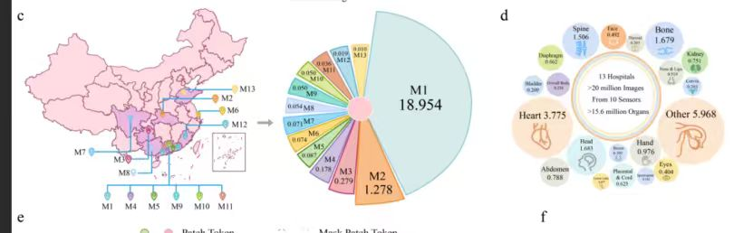
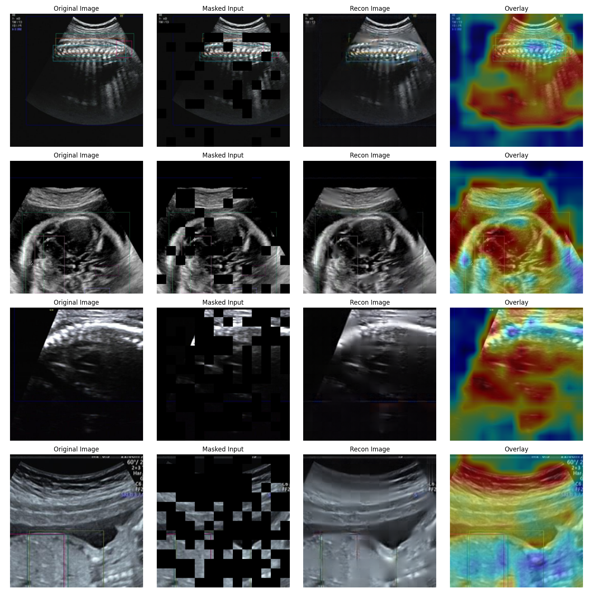
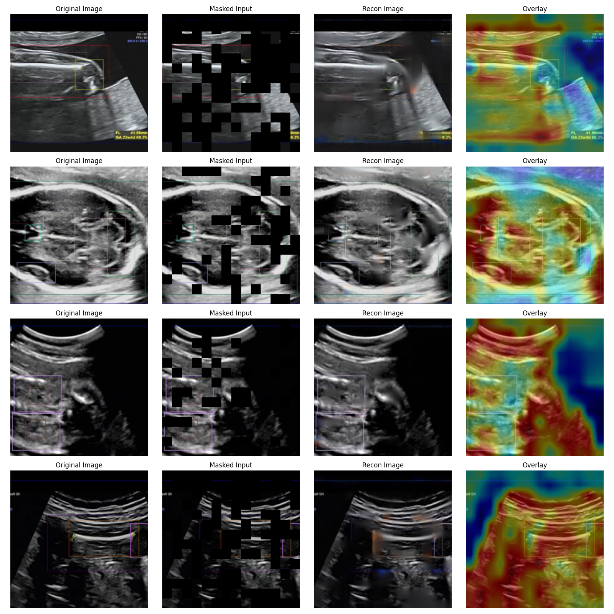
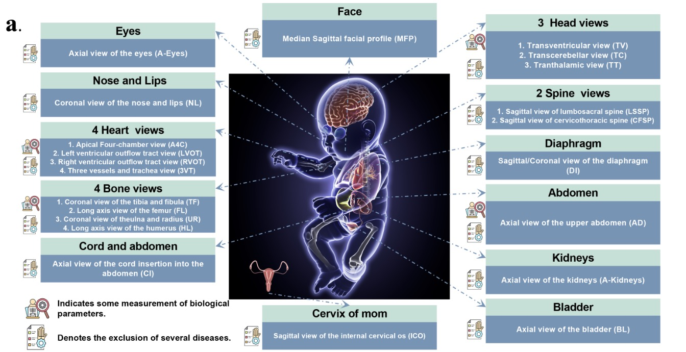
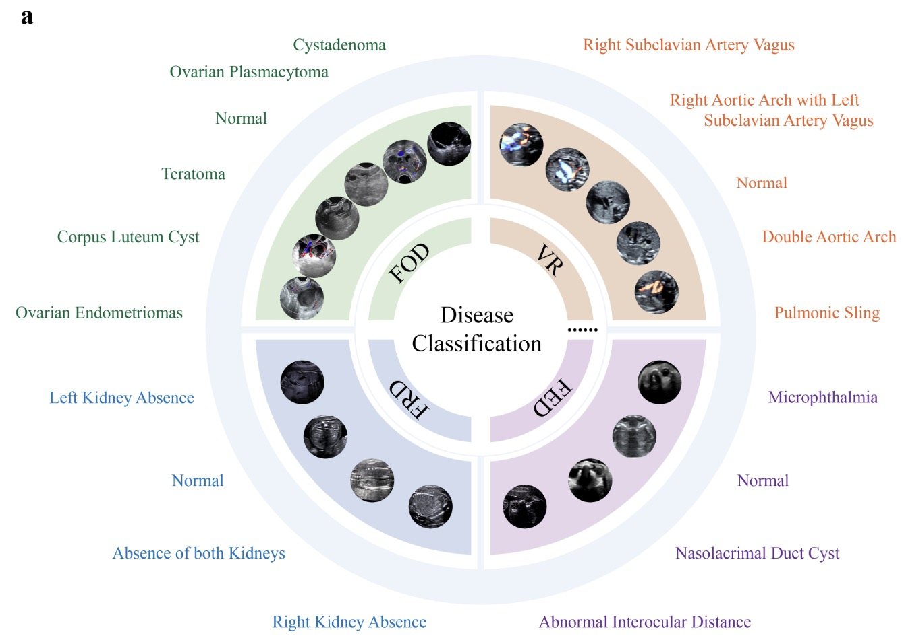
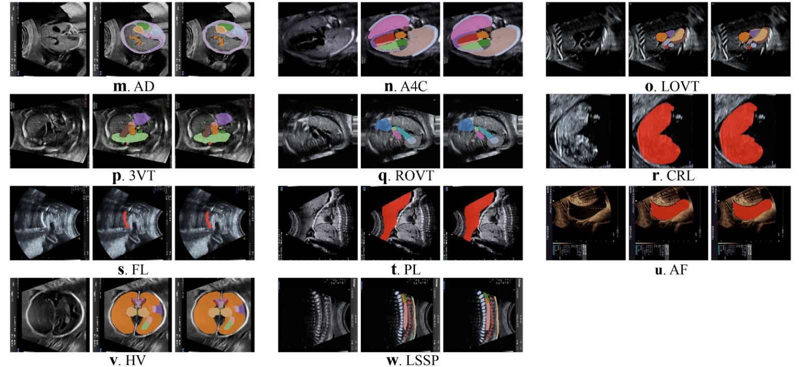
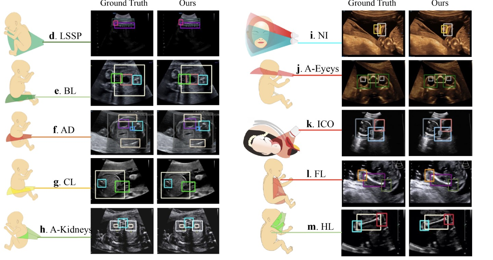

<div align="center">
  <h1>SonoNexus</h1>
  <h3>A Universal Foundation Model for Sensor-Agnostic Ultrasound Imaging</h3>

  <p>
    <b>Unified ultrasound representation</b> ·
    <b>Masked image reconstruction</b> ·
    <b>Downstream clinical transfer</b>
  </p>

  <p>
    <a href="#quick-start">Quick Start</a> ·
    <a href="#demo-data-for-fast-implementation">Demo Data</a> ·
    <a href="#pre-training">Pre-training</a> ·
    <a href="#downstream-demos">Downstream Demos</a> ·
    <a href="#feature-visualization">Feature Visualization</a>
  </p>
</div>

## Highlights

SonoNexus is a foundation model for ultrasound images across heterogeneous scanners, hospitals, organs, and clinical tasks. It is designed as a sensor-agnostic representation learner: a single pre-trained model can be transferred to view classification, disease diagnosis, organ segmentation, and detection-style downstream workflows.

| Component | Status | Entry point |
| --- | --- | --- |
| MAE-style ultrasound pre-training | Available | `main_mae_cnn.py`, `train_mae_cnn.py` |
| Mask generation and augmentation | Available | `dataset_mae_cnn.py` |
| SonoNexus backbone | Available | `model/swin.py` |
| Pre-trained checkpoint loader | Available | `load_model.py` |
| LoRA downstream utilities | Available | `sononexus_downstream.py` |
| Downstream classification demo | Available | `train_classification_demo.py` |
| Downstream diagnosis demo | Available | `train_diagnosis_demo.py` |
| Downstream segmentation demo | Available | `train_segmentation_demo.py` |
| Feature and reconstruction visualization | Available | `visualize_pretrained_features.py` |

## News

- **2025-11**: Initial SonoNexus project setup.
- **2026-06**: Added downstream training demos and a polished feature visualization toolkit.

## Overview

SonoNexus is built around two central ideas:

1. **Sono-21M scale**: a large ultrasound corpus with 21.14M images, 20 major organ types, 10 mainstream sensor models, and multi-center acquisition across 13 hospitals.
2. **Self-supervised transfer**: masked ultrasound reconstruction and contrastive regularization encourage robust anatomical features that can transfer across scanners and tasks.

<div align="center">
  
</div>

## Quick Start

Install dependencies with `python -m pip install -r requirements.txt`. The source was checked on macOS with PyTorch 2.15.0, torchvision 0.29.2 and timm 1.0.31. CUDA training uses FP16; CPU execution disables CUDA AMP.

```bash
python main_mae_cnn.py \
  -data /path/to/pretraining/images \
  --batch_size 512 \
  --epochs 300 \
  --imgsize 224 \
  --gpus 0,1,2,3
```

The pre-training dataset is expected to be an image folder. `dataset_mae_cnn.py` recursively scans common image extensions and creates random block masks for MAE reconstruction.

## Demo Data for Fast Implementation

### Pre-training

Unlabeled ultrasound images for self-supervised masked image reconstruction and contrastive learning. Use `main_mae_cnn.py` as the training entry point.

**Download:** To be added.

### SFT-Segmentation

Ultrasound images paired with pixel-wise segmentation masks for organ and lesion segmentation. Use `train_segmentation_demo.py` as the training entry point.

**Download:** To be added.

### SFT-Classification

Ultrasound images with class labels for view and organ classification. Use `train_classification_demo.py` as the training entry point.

**Download:** To be added.

### SFT-Detection

Ultrasound images with bounding-box annotations and class labels for anatomical structure detection.

**Download:** To be added.

## Pre-training

The pre-training model is implemented in `model/swin.py`.

- **Backbone**: Swin-B from `timm`, trained from scratch, retaining standard depths `(2, 2, 18, 2)` (24 blocks) and feature channels `(128, 256, 512, 1024)`. Only the patch-embedding projection is changed to 2x2. The original initialization is preserved: create the patch4 model first, then replace only `patch_embed.proj` with `Conv2d(3, 128, kernel_size=2, stride=2)`. Stored patch/grid metadata and window/shift settings retain their original values; this is intentionally different from constructing a native patch2 model.
- **Objective 1**: masked image reconstruction on ultrasound patches.
- **Objective 2**: contrastive alignment of average-pooled final-stage features after the shared `merge` projection (`Linear(1024, 768)`), using a full augmented view and a masked second augmented view. Reconstruction targets the second view, preserving spatial correspondence.
- **Training loop**: `train_mae_cnn.py` with TensorBoard/W&B logging and reconstruction previews.

Pre-trained model weights can be downloaded from:
[Google Drive checkpoint folder](https://drive.google.com/drive/folders/1Ff7fdXIGN9nsWqf9la0Tc7kYRKxFds04?usp=drive_link)

`model/swin.py` is the single architecture definition. Stage 3 supplies the reconstruction decoder (four 512-dimensional Transformer blocks, eight heads, a `ReLU + Linear(512, 192)` output head, and 8x8 RGB output patches). Stage 4 supplies 1024-dimensional average tokens, projected to 768 dimensions by `merge` for contrastive learning. Embedding patches are 2x2; masking and reconstruction patches are 8x8.

Paper pretraining defaults: 224x224 input, 300 epochs, total batch size 512, AdamW betas `(0.9, 0.95)`, weight decay 0.05, and `lr = 1.5e-4 * batch_size / 256` (3e-4 at batch size 512). A 10-epoch linear warm-up precedes cosine decay. `--lr` optionally overrides the scaled learning rate.

Each image produces two independently augmented views: random resized crop (scale 0.2–1.0), horizontal flip (p=0.5), color jitter (0.4/0.4/0.2/0.1, p=0.8), random grayscale (p=0.2), and Gaussian blur (kernel 23, sigma 0.1–2.0; p=0.5/0.1). Mask ratios are uniform in 0.1–0.8. The loss retains the original separately averaged masked/visible L1 terms and InfoNCE (temperature 0.07, contrastive weight 1 by default).

`load_model.py` reuses the same encoder, reconstruction decoder and `merge` projection for full-model loading, and checks all model weights. Downstream loading constructs only the encoder, ignores both pretraining heads in full pretraining checkpoints, and strictly validates every encoder key. Reuse the timm version from the original training environment when reproducing published checkpoints; successful state-dict loading alone does not verify non-parameter window/shift behavior. Raw encoder state dicts, full pretraining state dicts and `state_dict`-wrapped checkpoints with optional `module.` prefixes are supported.

```bash
python load_model.py \
  --checkpoint /path/to/timm_model_99.pth \
  --encoder-only \
  --output /path/to/encoder.pth
```

<div align="center">
  
  
</div>

## Downstream Demos

The repository now provides three clean demo trainers in the project root. Each downstream script follows the same transfer recipe:

- load the SonoNexus pre-trained model
- freeze the pre-trained backbone weights
- inject trainable LoRA adapters only into the Q and V slices of every fused Swin attention projection; K, attention output, MLP and patch-merging projections remain frozen
- train only LoRA parameters and the task-specific head/decoder

Fine-tuning directly builds the same encoder and never allocates or loads the pretraining reconstruction decoder. The segmentation task retains its own task-specific UNet-like decoder.

Paper fine-tuning defaults: LoRA rank 8, alpha 16 and adapter dropout 0; AdamW betas `(0.9, 0.999)`; adapter LR 2e-4 and task-head/segmentation-decoder LR 1e-3; weight decay 0.01; batch size 64; up to 50 epochs; five-epoch linear warm-up then cosine decay; gradient clipping at norm 1.0; label smoothing 0.1. For BCE tasks, smoothing moves targets toward 0.5. Validation macro AUC selects the best checkpoint and stops training after 10 epochs without improvement. Segmentation uses pixel-wise one-vs-rest macro AUC for this stopping rule, matching the current manuscript's AUC criterion.

Dataset definitions are lightweight: replace **both** `build_train_loader(args)` and `build_val_loader(args)` with real patient-disjoint datasets. The provided synthetic validation set is fixed and separate from synthetic training data. `get_finetune_transform` in `finetune_training.py` supplies random resized crop, horizontal flip and normalization, without color jitter or Gaussian blur. For segmentation, apply identical crop/flip parameters to the image and mask and use nearest-neighbor mask interpolation. Each validation class/label must contain both positive and negative examples to calculate AUC.

The commands below override batch size and epoch count for short demo runs. Omitting those flags uses paper defaults.

### 1. Fetal View / General Classification

Use this for mutually exclusive classes such as fetal ultrasound view classification or organ category classification.

```bash
python train_classification_demo.py \
  --checkpoint /path/to/sononexus_pretrained.pth \
  --num-classes 5 \
  --lora-rank 8 \
  --batch-size 8 \
  --epochs 2
```

Loss: `CrossEntropyLoss`. Trainable modules: LoRA adapters plus the classification head.

<div align="center">
  
</div>

### 2. Disease Diagnosis

Use this for binary or multi-label disease diagnosis. The demo head produces `num_labels` logits and trains with `BCEWithLogitsLoss`.

```bash
python train_diagnosis_demo.py \
  --checkpoint /path/to/sononexus_pretrained.pth \
  --num-labels 4 \
  --lora-rank 8 \
  --batch-size 8 \
  --epochs 2
```

Loss: `BCEWithLogitsLoss`. Trainable modules: LoRA adapters plus the multi-label diagnosis head.

<div align="center">
  
</div>

### 3. Organ / Lesion Segmentation

Use this for binary masks or multi-class masks. The demo extracts multi-scale features from the frozen SonoNexus backbone and feeds them into a UNet-like decoder with skip connections.

```bash
python train_segmentation_demo.py \
  --checkpoint /path/to/sononexus_pretrained.pth \
  --num-classes 1 \
  --lora-rank 8 \
  --batch-size 4 \
  --epochs 2
```

Loss:

- `BCEWithLogitsLoss + Dice loss` for `--num-classes 1`
- `CrossEntropyLoss` for `--num-classes > 1`

Trainable modules: LoRA adapters plus the UNet-like decoder. The frozen pre-trained model supplies four Swin feature scales.

<div align="center">
  
</div>

## Feature Visualization

`visualize_pretrained_features.py` provides a complete visualization workflow for pre-trained SonoNexus checkpoints:

- masked-input reconstruction preview
- average-pooled token similarity map
- max-pooled token similarity map
- PCA projection of global image embeddings
- CSV export of embedding coordinates

```bash
python visualize_pretrained_features.py \
  --image-dir /path/to/ultrasound/images \
  --checkpoint /path/to/sononexus_pretrained.pth \
  --output-dir outputs/feature_visualization \
  --anchor both \
  --max-images 128
```

Outputs:

| File | Description |
| --- | --- |
| `feature_gallery.png` | Original, masked input, reconstruction, and similarity overlays |
| `embedding_pca.png` | 2D PCA view of SonoNexus global features |
| `embedding_pca.csv` | Image path, folder label, PC1, and PC2 |

If images are arranged as `root/class_name/image.png`, parent folder names are used as labels in the PCA plot. If images are placed directly under one folder, they are treated as `unlabeled`.

## Supported Clinical Tasks

| Task | Typical head | Demo |
| --- | --- | --- |
| Fetal ultrasound view classification | frozen backbone + LoRA + pooled classifier | `train_classification_demo.py` |
| Disease classification / diagnosis | frozen backbone + LoRA + multi-label head | `train_diagnosis_demo.py` |
| Organ or lesion segmentation | frozen backbone + LoRA + multi-scale UNet-like decoder | `train_segmentation_demo.py` |
| Anatomical structure detection | detector head on SonoNexus features | planned |

<div align="center">
  
</div>

## Repository Layout

```text
SonoNexus-main/
├── dataset_mae_cnn.py                    # Pre-training image loader and mask generator
├── main_mae_cnn.py                       # Pre-training launch script
├── train_mae_cnn.py                      # Pre-training loop and logging
├── load_model.py                         # Shared model loader and encoder-only export
├── training_utils.py                     # Linear warm-up and cosine scheduler
├── finetune_training.py                   # Paper fine-tuning settings and validation/early stopping
├── sononexus_downstream.py               # Frozen backbone, LoRA, downstream heads/decoder
├── train_classification_demo.py          # LoRA multi-class classification demo
├── train_diagnosis_demo.py               # LoRA multi-label diagnosis demo
├── train_segmentation_demo.py            # LoRA multi-scale UNet-like segmentation demo
├── visualize_pretrained_features.py      # Reconstruction and feature visualization
├── model/
│   ├── swin.py                           # SonoNexus MAE backbone
│   ├── mednext.py                        # MedNeXt encoder experiments
│   └── vqvae.py
└── imgs/                                 # README figures
```

## Notes for Custom Datasets

To connect private datasets, edit the `build_train_loader(args)` and `build_val_loader(args)` functions in the corresponding downstream demo. The model expects normalized RGB tensors shaped `[B, 3, H, W]`. For ultrasound grayscale images, convert to RGB by channel repetition or `PIL.Image.convert("RGB")` before normalization.

Recommended normalization is the ImageNet convention already used by pre-training:

```python
mean = [0.485, 0.456, 0.406]
std = [0.229, 0.224, 0.225]
```

## License

This project is released under the Apache 2.0 License.

## Verification

Run `python -m unittest discover -s tests -v` from this directory. Tests verify identical seeded parameters, grids, attention masks, shifts and 224x224 forward outputs against standard Swin-B with the original patch-projection replacement and `(2, 2, 18, 2)` depths, and exercise two-view pretraining gradients through the reconstruction and contrastive heads, strict full/encoder checkpoint loading, rejection of incomplete encoder weights, Q/V-only LoRA updates with an unchanged K slice, the downstream heads, the augmentation/mask pipeline, optimizer groups, warm-up/cosine decay and validation-based early stopping. No pretrained weights or clinical datasets are bundled; synthetic tests validate code behavior, not paper results.
